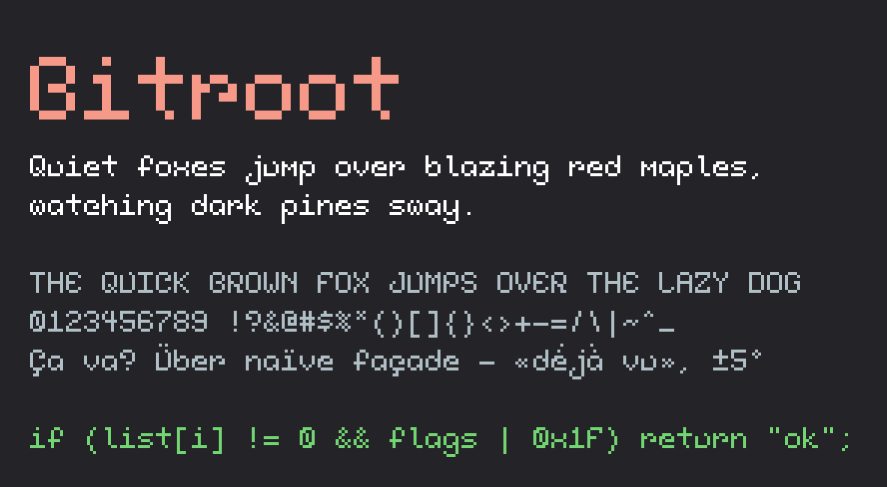
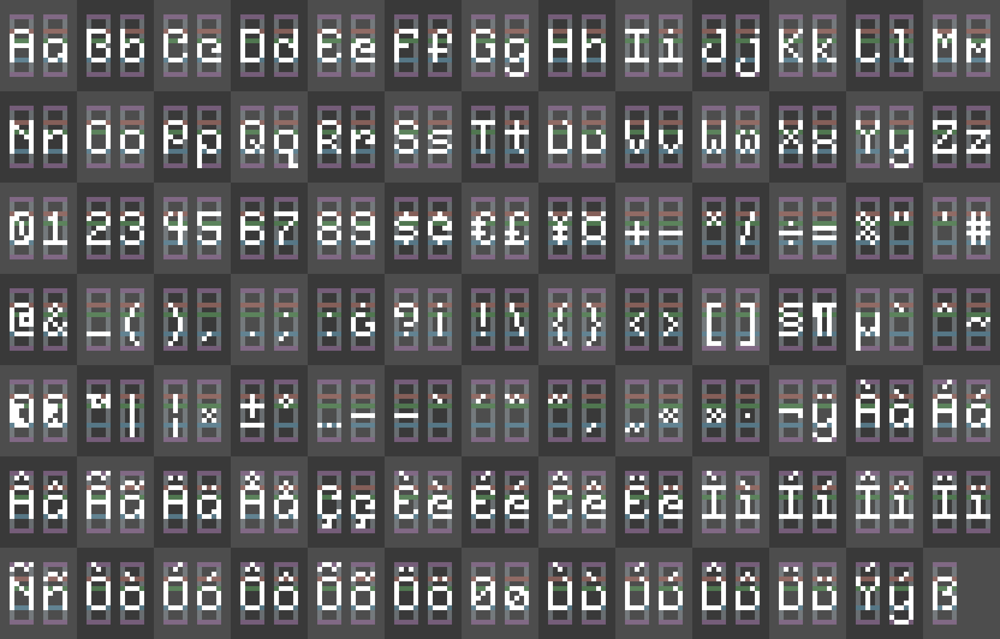

# Bitroot

> [!NOTE]
> **Bitroot is at version 0.x. Glyphs and metrics may still change between versions.**

<p align="center">
  
</p>

**Bitroot** is a low-resolution, blocky, **monospaced** pixel font drawn in [Aseprite](https://www.aseprite.org/). It stays crisp and readable at small sizes.

**[Download the latest release](https://github.com/serialexperimentsrio/bitroot/releases)**, or grab [`bitroot.ttf`](bitroot.ttf) and [`bitroot.woff2`](bitroot.woff2) from this repository.

## Specifications

Each character fits within a **5×13-pixel cell**, with the **baseline 10px from the top**. Capital letters are **7px tall**, while lowercase letters have a **5px x-height** measured upward from the baseline.

**Ascenders** in `b`, `d`, `f`, `h`, and `l` extend to match the capital height (`k` stays at x-height), while descenders (`g`, `j`, `p`, `q`, and `y`) drop **3 pixels below** the baseline. The **3 pixels above** the capitals hold the accents of accented capitals (`À`, `Ö`, `Ñ`…), and they keep capitals centered in the line.

Every glyph advances **6px** (5px cell + 1px spacing), so text lines up in columns. Symbols and punctuation are drawn at whatever width inside the cell looks best.

### Sizes

One font pixel is exactly 1/10 of the font size, and the line height is 13 font pixels (`line-height: 1.3`). Use the font at a **multiple of 10px** (10px, 20px, 30px…) so every font pixel lands on whole screen pixels. Other sizes work, but they will look blurry.

### Character set

- All printable ASCII
- Latin-1 accented letters: `ÀÁÂÃÄÅÇÈÉÊËÌÍÎÏÑÒÓÔÕÖØÙÚÛÜÝ àáâãäåçèéêëìíîïñòóôõöøùúûüýÿß`
- Punctuation and symbols: `¡¿«»‘’‚“”„…–—·|¦¬±×÷°§¶µ¢€£¥¤©®™`

Not drawn yet: `Æ æ Œ œ Ð ð Þ þ`.

<p align="center">
  
</p>

## Usage

Install `bitroot.ttf` like any other font. On the web, use the WOFF2 file:

```css
@font-face {
  font-family: "Bitroot";
  src: url("bitroot.woff2") format("woff2");
}

body {
  font-family: "Bitroot", monospace;
  font-size: 20px;
}
```

## Contributing

Use imperative, properly cased commit messages that name the glyphs you changed (for example, "Add glyph for ampersand" or "Redraw g and y").

### Workflow

1. Edit `src/bitroot-typeface.aseprite` in [Aseprite](https://www.aseprite.org/). Draw glyphs on the layers inside the `Glyphs` group.
2. To add a glyph, draw it in an empty cell. Then add its character to `rows` in `src/font.json`, at the same row and column.
3. Build the font files and the README images:

   ```sh
   pip install -r requirements.txt
   python build.py
   ```

4. Submit a PR with the `.aseprite` file, `src/font.json` (if changed), and the rebuilt `bitroot.ttf`, `bitroot.woff2`, `preview.png`, and `specimen.png`.

`build.py` checks every glyph outline against the sheet. Accented letters are separate drawings, so it also warns when one no longer matches its base letter (for example, after redrawing `A` but not `À`). CI rebuilds the fonts and fails if the committed font files don't match the `.aseprite` source.

### Releasing

Set `version` in `src/font.json`, rebuild, commit, then push a matching tag (for example `v0.2`). CI publishes a GitHub release with a zip of the font files. Versions below 1.0 are marked as pre-releases.

> [!TIP]
> **Aseprite is paid software ($19.99 USD), but its source code is available on GitHub, so it can be built and installed for free.**
>
> **[Click here for releases and build instructions.](https://github.com/aseprite/aseprite/releases)**

## License

This font is licensed under the [SIL Open Font License 1.1](LICENSE.txt).
