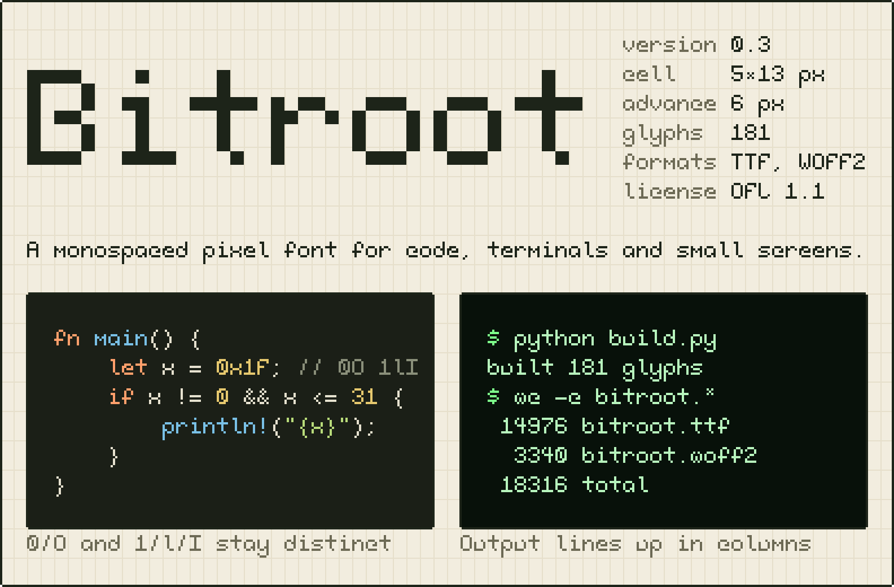
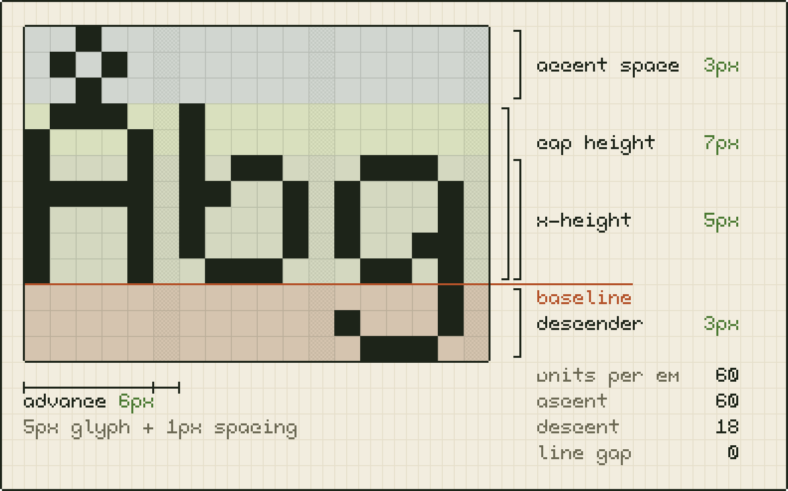
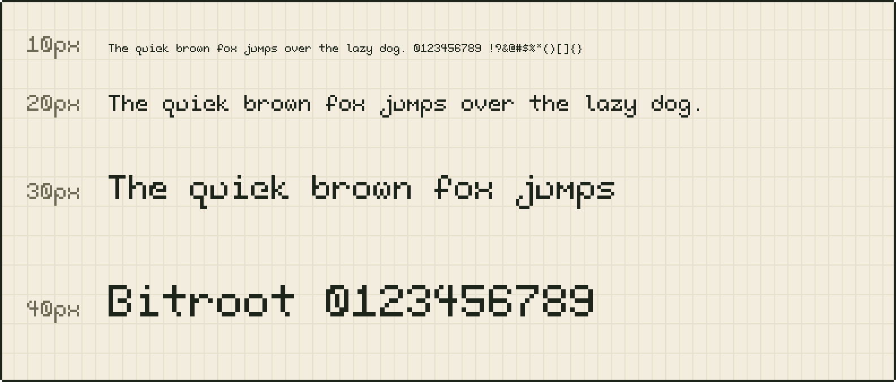
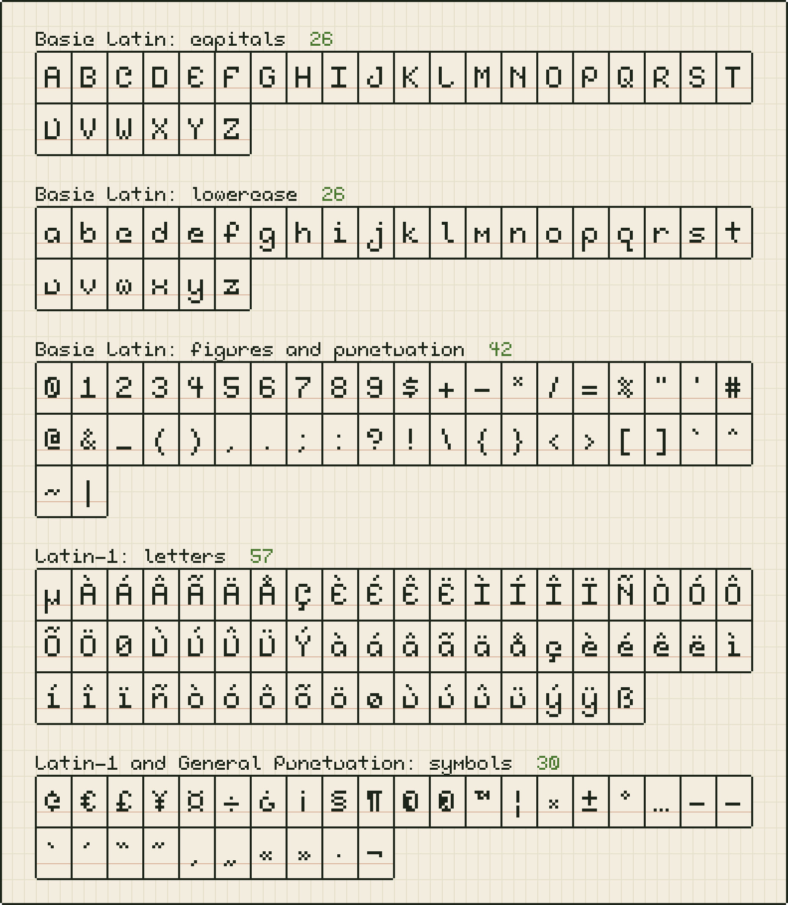

# Bitroot

> [!NOTE]
> **Bitroot is at version 0.x. Glyphs and metrics may still change between versions.**

<p align="center">
  
</p>

**Bitroot** is a monospaced pixel font. Every glyph is drawn on a 5×13 pixel grid in [Aseprite](https://www.aseprite.org/) and converted to TrueType outlines, so it renders without blur at every multiple of 10px.

**[Try it in the browser](https://serialexperimentsrio.github.io/bitroot/)** · **[Download the latest release](https://github.com/serialexperimentsrio/bitroot/releases)** · [`bitroot.ttf`](bitroot.ttf) · [`bitroot.woff2`](bitroot.woff2)

| Property | Value |
| --- | --- |
| Classification | Monospaced pixel font, one style (Regular) |
| Cell | 5×13 px, 6 px advance |
| Cap height, x-height | 7 px, 5 px |
| Ascent, descent | 10 px, 3 px (3 px of the ascent is accent space) |
| Units per em | 60: 1 em = 10 px, 6 units per pixel |
| Line height | 13 px per 10 px of font size (`line-height: normal` is 1.3) |
| Coverage | 181 glyphs: printable ASCII, Latin-1 letters and symbols, common punctuation |
| Formats | TrueType (`.ttf`), WOFF2 (`.woff2`) |
| License | SIL Open Font License 1.1 |

## Metrics

<p align="center">
  
</p>

- **Cell.** Every glyph sits in a 5×13 pixel cell with the baseline 10 px from the top, and advances 6 px: 5 px for the glyph and 1 px of spacing. Text always lines up in columns.
- **Vertical metrics.** Capitals are 7 px tall and the x-height is 5 px. The ascenders of `b`, `d`, `f`, `h` and `l` reach the cap height, while `k` stays at the x-height. The descenders of `g`, `j`, `p`, `q` and `y` drop 3 px below the baseline.
- **Accent space.** The top 3 px of the cell are reserved for the accents of accented capitals (`À`, `Ö`, `Ñ`…). They are part of the ascent, so accents never touch the line above, and unaccented capitals sit centred in the line.
- **Widths.** Symbols and punctuation use whatever width inside the 5 px cell suits them; only the advance is fixed.

### Font tables

- **Outlines.** Each pixel is a 6×6 unit square. Squares that share an edge are merged into a single outline (with holes where a shape has counters), and pixels that only touch at a corner stay separate. At whole-pixel sizes every edge falls on a pixel boundary, so the font needs no hinting.
- **Line metrics.** `hhea` ascent/descent, `OS/2` typo ascender/descender and `OS/2` win ascent/descent are all 60 and 18, with a line gap of 0. `USE_TYPO_METRICS` is set, so the line height is the same on every platform.
- **Monospacing.** Every glyph, including `.notdef`, advances 36 units. `post.isFixedPitch` is 1 and the PANOSE proportion is 9 (monospaced), so terminals and code editors list Bitroot as a monospaced font.
- **Mapping.** No-break space (U+00A0) uses the space glyph. `.notdef` is a hollow box the height of a capital.

## Sizes

<p align="center">
  
</p>

One font pixel is exactly a tenth of the font size. Use a multiple of 10px so that every font pixel covers a whole number of screen pixels.

| `font-size` | Screen pixels per font pixel | Line height |
| --- | --- | --- |
| 10px | 1 | 13px |
| 20px | 2 | 26px |
| 30px | 3 | 39px |
| 40px | 4 | 52px |

On a display with scaling, one CSS pixel is `devicePixelRatio` device pixels, so a font pixel is `font-size / 10 × devicePixelRatio` device pixels. Keep that a whole number. For example, at 150% scaling 20px gives 3 device pixels per font pixel, but at 125% it gives 2.5 and blurs, so use 40px there. The [specimen site](https://serialexperimentsrio.github.io/bitroot/) snaps its sizes this way.

## Character set

<p align="center">
  
</p>

- All printable ASCII
- Latin-1 letters: `ÀÁÂÃÄÅÇÈÉÊËÌÍÎÏÑÒÓÔÕÖØÙÚÛÜÝ àáâãäåçèéêëìíîïñòóôõöøùúûüýÿß µ`
- Punctuation and symbols: `¡¿«»‘’‚“”„…–—·|¦¬±×÷°§¶¢€£¥¤©®™`

Not drawn yet: `Æ æ Œ œ Ð ð Þ þ`.

## Usage

### Desktop

Install `bitroot.ttf` like any other font, then select **Bitroot** at a multiple of 10px. For example, in VS Code:

```json
{
  "editor.fontFamily": "Bitroot",
  "editor.fontSize": 20,
  "editor.lineHeight": 26,
  "terminal.integrated.fontFamily": "Bitroot"
}
```

### Web

Serve the WOFF2 file yourself:

```css
@font-face {
  font-family: "Bitroot";
  src: url("bitroot.woff2") format("woff2");
}

body {
  font-family: "Bitroot", monospace;
  font-size: 20px;
  line-height: normal; /* 1.3, built into the font */
  -webkit-font-smoothing: none; /* macOS: keep edges hard */
}
```

Or load it from jsDelivr, pinned to a release tag:

```css
src: url("https://cdn.jsdelivr.net/gh/serialexperimentsrio/bitroot@v0.3/bitroot.woff2") format("woff2");
```

## Building

The source is the Aseprite file. `build.py` reads it directly, so Aseprite is only needed to edit glyphs, not to build.

```sh
pip install -r requirements.txt
python build.py
```

| Path | Contents |
| --- | --- |
| `src/bitroot-typeface.aseprite` | The glyph sheet. Glyphs are drawn on the layers inside the `Glyphs` group. |
| `src/font.json` | Metadata, metrics and the character in each cell of the sheet (`rows`). |
| `build.py` | The build script. |
| `bitroot.ttf`, `bitroot.woff2` | Built fonts, committed. |
| `images/` | Built README images. |
| `demo/` | The specimen site. `demo/glyphs.json` is built. |

The build:

1. Parses the `.aseprite` file (RGBA, first frame) and flattens the layers of the `Glyphs` group.
2. Cuts the sheet into cells using `cell-offset`, `cell-gap` and `rows` from `src/font.json`.
3. Traces each glyph into outlines and writes `bitroot.ttf` and `bitroot.woff2`. Timestamps come from `src/font.json`, so the same source always produces byte-identical files.
4. Checks every pixel centre of every glyph against its outline, and checks that every advance is the same.
5. Warns when an accented letter no longer matches its base letter (for example, after redrawing `A` but not `À`), because accented letters are separate drawings.
6. Draws the README images from the glyph bitmaps and writes `demo/glyphs.json`.

CI runs the build on every push and fails if the committed font files don't match the `.aseprite` source. Every push to `main` also publishes `demo/` to GitHub Pages. To preview the site locally, run `python -m http.server` in the repository folder and open `http://localhost:8000/demo/`.

## Contributing

1. Edit `src/bitroot-typeface.aseprite` in [Aseprite](https://www.aseprite.org/).
2. To add a glyph, draw it in an empty cell, then add its character to `rows` in `src/font.json` at the same row and column.
3. Run `python build.py`.
4. Open a pull request with the `.aseprite` file, `src/font.json` (if changed), the rebuilt fonts, `images/` and `demo/glyphs.json`.

Write commit messages in the imperative mood, properly cased, and name the glyphs you changed (for example, "Add glyph for ampersand" or "Redraw g and y").

Thanks to [TakWolf](https://github.com/TakWolf), whose suggestions in [#1](https://github.com/serialexperimentsrio/bitroot/pull/1) led to the Python build, the release workflow and the 3 px accent space.

> [!TIP]
> **Aseprite is paid software ($19.99 USD), but its source code is available on GitHub, so it can be built and installed for free.**
>
> **[Click here for releases and build instructions.](https://github.com/aseprite/aseprite/releases)**

### Releasing

Set `version` in `src/font.json`, rebuild, commit, then push a matching tag (for example `v0.4`). CI publishes a GitHub release with a zip of the font files. Versions below 1.0 are marked as pre-releases.

## License

Bitroot is licensed under the [SIL Open Font License 1.1](LICENSE.txt).
